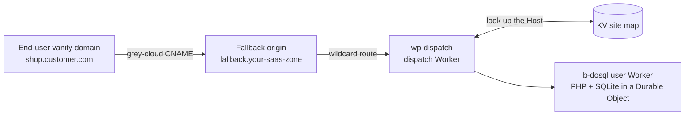
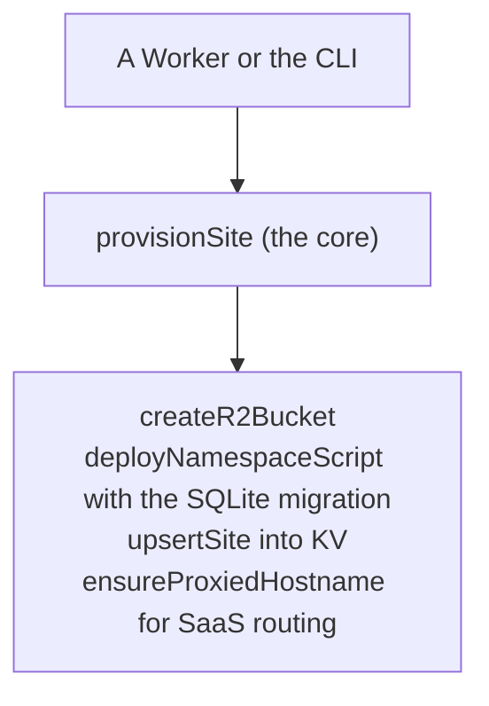

# A multi-tenant WordPress and WooCommerce framework on Workers for Platforms

Run many WordPress sites, including WooCommerce stores, on YOUR OWN Cloudflare Workers for Platforms account. Every site is made by one command or by a Worker. This is a framework you run on your account. It is not a hosting product and not a sign-up flow. You can build it again from these docs on a clean account.

The key idea: the provisioning core is only Cloudflare API calls (fetch plus Web Crypto). The SAME code that a CLI runs can run inside a Worker. So a Worker can make a new site. Design and proofs: issues #35, #154, #152, #182.

New to this from a traditional LAMP WordPress host (a Linux box with Apache or nginx, PHP, and MySQL)? Start with [docs/from-lamp-to-wfp.md](from-lamp-to-wfp.md), which maps your stack one-to-one onto this one, then come back here for the commands and prerequisites.

## Two kinds of site: `wp` (b-dosql, the store path) and `a` (the scale-out path)

This page is about `wp` (called b-dosql), the kind with zero outside infrastructure. For scale-out, the second kind is `a`: PHP-WASM in a Worker with the database on a managed MySQL through Hyperdrive. It has its own flow in [onboarding.md](onboarding.md) (`site add --kind a`). Both kinds go through the same provisioning core.

A `wp` site is WordPress with PHP and its SQLite database inside one Durable Object. It runs as a user Worker in the dispatch namespace. A site can be:

- a content site (a blog or a brochure site); or
- a WooCommerce store. WooCommerce runs on b-dosql **including checkout**. This is measured on Workers Paid: an order places under the 128 MiB isolate limit, and `tests/woo.py` is green (see the README matrix and `docs/results.md`).

There is no container store. The older "c1" store path (WordPress in a Cloudflare Container) was retired in #214, because b-dosql now does checkout directly. Its notes stay as a record in [approach-c1.md](approach-c1.md). The CLI and the provisioning Worker refuse `kind: shop`.

**The limit to know:** a b-dosql site is one Durable Object, so it has 128 MiB of memory, one writer, and one region. A blog or a light-to-moderate store fits well. For a store with real concurrent traffic, use approach `a` ([onboarding.md](onboarding.md)), which scales sideways. A store that outgrows b-dosql can also go to a VPS (the normal LAMP stack). See [from-lamp-to-wfp.md](from-lamp-to-wfp.md) and [known-limitations.md](known-limitations.md).

## Default integrations

Provisioning is a table of descriptors (`B_DOSQL_DESCRIPTORS` in `deploy/provision/wp-site-config.mjs`). Each one wires a Cloudflare integration for a site, as an opinionated default or as an opt-in.

| Integration | Default |
| --- | --- |
| Base object cache, and the L2 KV object cache (per-site `OC_KV`) | On |
| WP-Cron on a Durable Object alarm | On |
| Images offload (Cloudflare Images) and R2 media | On |
| Email Sending (`EMAIL` binding) | On |
| PDF invoices (Browser Rendering) | Opt-in |
| Durable email through Queues ([async-email-durable-retry.md](async-email-durable-retry.md)) | Opt-in |
| AI alt-text (Workers AI) | Opt-in |
| Pageview analytics (Analytics Engine) | Opt-in |
| Semantic search (Vectorize, [vectorize-search.md](vectorize-search.md)) | Opt-in |
| Zone cache purge on publish | Opt-in |

Opt-in items are metered or need a lead-supplied token or a post-deploy step, so no site gets them unless the operator asks.

## Edge security (zone level)

These protect the SaaS home zone, so one rule covers every tenant. All of it is code, and it is proven live on a tenant.

- **WAF** (`deploy/wfp/terraform/shared/waf.tf`): the Cloudflare managed ruleset with the WordPress rules, and rate limits on `wp-login` and `xmlrpc`. A rate-limit rule must count by `cf.colo.id` as well as the client address. A Pro zone allows only 2 rate-limit rules. The rules never match wp-admin pages, the REST API, checkout or wp-cron.
- **Zone edge cache with purge on publish** (`deploy/zone/`): Cache Rules that bypass what WooCommerce must not cache. The last matching rule wins, so the order of the rules matters. See `deploy/zone/README.md`.
- **Access on `/wp-admin`** (`deploy/wfp/terraform/shared/access.tf`): an optional Cloudflare Access application that gates the admin by identity. Off unless a site opts in.

## How it fits together

One dispatch Worker routes every site by its hostname. An end user points their own domain at your SaaS zone with a CNAME; the wildcard route hands the request to the dispatcher, which reads the KV site map and runs the right user Worker.



Provisioning is one core with two callers (a CLI or a Worker). Every step is an idempotent Cloudflare API call, so no build runs when you make a site. "Idempotent" means you can run a step again and it does no harm.



## What you need (on your own account)

- A Cloudflare account on the **Workers for Platforms Paid** plan, and your **account id**.
- An **API token** with edit on: Workers KV, Workers for Platforms, R2, and DNS for the one SaaS zone. A provisioning Worker uses one token with only these scopes. It holds no token-minting scope and no Containers scope (see `deploy/provision/HARDENING.md`).
- **Node and Wrangler** (4.107.0 or later), and this repository.
- One built-once artifact (the provisioning core never builds when you make a site): the **b-dosql worker bundle**, built with `deploy/wfp` / `spikes/b2-wordpress`. You build it once; every site uses it.
- The shared pieces once (the dispatch namespace, the KV site map, the outbound Worker): `deploy/wfp/up.sh` makes them. Note the KV site map id; the core reads and writes it.

Nothing is configured in the dashboard; everything below is a command or an API call.

## The one surface: provision a site

The core CLI is `deploy/provision/cli.mjs` (alias it to `site`). It calls `provisionSite`, the same function the provisioning Worker calls.

```sh
export CLOUDFLARE_ACCOUNT_ID=<your account id>
export CLOUDFLARE_API_TOKEN=<the token above>
export WFP_NAMESPACE=wp-wfp
export WFP_KV_ID=<the wp-wfp-sites map id>
export WFP_SUBDOMAIN=<your workers.dev subdomain, or a routed zone>

# a WordPress site (a blog, or a WooCommerce store: same command)
export BDOSQL_BUNDLE_DIR=<the built b-dosql bundle dir>
node deploy/provision/cli.mjs add --kind wp blog
```

A store is the same kind of site. You turn on WooCommerce inside the site, as you would on any WordPress host.

`add` is idempotent and does only its own site. It creates the media bucket, deploys the namespace script with the site's secrets inside the same upload, and writes the KV routing entry. Today `cli.mjs` implements `add` only. To remove, list or update a site, use the `deploy/wfp/site` flow (see `docs/operator.md`), which also shows how to snapshot a site and go back.

## Provision from a Worker

Because the core is only `fetch` plus Web Crypto, a Worker can make a site. `deploy/provision/worker.mjs` does this. You send it a bearer token and three fields, and it calls the same `provisionSite`.

```sh
curl -X POST https://<your-provisioning-worker>/ \
  -H "authorization: Bearer $PROVISION_AUTH" \
  -H 'content-type: application/json' \
  --data '{"kind":"wp","name":"blog","domain":"<one of the base domains the Worker owns>"}'
```

The caller sends ONLY `kind` (always `wp`), `name` and `domain`. The Worker keeps the pre-built bundle, the namespace, the KV id and the zone in its own trusted config. A caller cannot upload code or aim at another site's resources. The Worker never builds a bundle. This is how a control plane or a customer UI can make a site: it calls a Worker. The hardening is in `deploy/provision/HARDENING.md`. The Worker also has a public `/demo` door (Turnstile, short-lived demo sites) that cleans up after itself.

## The SaaS zone (one-time setup)

End-user vanity domains reach the dispatcher through one SaaS zone, wired once. The dispatcher (`wp-dispatch`) routes by the request `Host` through the KV site map, so adding a site is a KV entry plus a custom hostname, never a new route.

1. Enable Cloudflare for SaaS on the zone (it needs the SSL-for-SaaS entitlement allocated to the account).
2. Add an originless fallback origin and set it as the zone's SaaS fallback:

```sh
# AAAA fallback.<saas-zone> -> 100:: (proxied), then mark it the fallback origin
curl -X POST "$B/zones/$ZONE/dns_records" -H "$AUTH" \
  --data '{"type":"AAAA","name":"fallback.<saas-zone>","content":"100::","proxied":true}'
curl -X PUT "$B/zones/$ZONE/custom_hostnames/fallback_origin" -H "$AUTH" \
  --data '{"origin":"fallback.<saas-zone>"}'
```

3. Point a `*/*` Worker route at the dispatcher:

```sh
curl -X POST "$B/zones/$ZONE/workers/routes" -H "$AUTH" \
  --data '{"pattern":"*/*","script":"wp-dispatch"}'
```

`*/*` is the Cloudflare-recommended pattern: it catches every custom hostname entering the zone whatever the customer's DNS proxy mode. It also catches the zone's own subdomains, so use a DEDICATED zone with no other traffic. On a zone that also serves your own sites, either exclude them with more-specific routes that name no Worker, or route each vanity domain by its own hostname (`vanity.customer.com`) instead of `*/*`; a per-hostname route only fires when the customer's record is grey-clouded (DNS-only), which is why `*/*` on a dedicated zone is the robust default.

Live reference: this project's own home is `skyphusionwp.dev`. Fallback `fallback.skyphusionwp.dev` (AAAA `100::`), `*/*` to `wp-dispatch`, proven end to end: an end-user vanity domain on a separate zone, grey-cloud CNAME to the fallback, served WordPress over HTTPS with an active certificate.

## Bring your own domain (two ownership modes)

End users reach a site on a vanity domain through Cloudflare for SaaS, routed by the dispatcher. The op `addCustomHostname({mode, dcvDelegation?})` supports two ownership modes that differ ONLY in who places the DNS records.

- **managed** (you or an agency hold the domain, its zone is on an account you control): the op places the CNAME to the SaaS fallback and the DCV record via the API. Hands-off.
- **delegated** (the CUSTOMER holds the domain): the op touches NONE of the customer's DNS. It returns the exact records for the customer to add in their own registrar (the CNAME target and the DCV name and value), then polls until the hostname and certificate are active. With `dcvDelegation`, it also emits a one-time `_acme-challenge` delegation CNAME, so certificate RENEWALS validate automatically without the customer touching DNS again.

**Anti-hostage, and it is the point:** in delegated mode the customer keeps their domain and their registrar, CNAMEs to you, and can repoint away at any time. You never hold their domain. If you move on, they change one CNAME. (This is a direct answer to the agency-holds-your-domain-hostage problem.)

The operator path is one command per side: `site hostname add <name> --domain <d> --mode delegated --dcv-delegation` prints the records the customer adds, and `site hostname status <name>` polls until the certificate is active. The full self-service walkthrough is in [byo-domain.md](byo-domain.md).

## Honest limits

- A site is ONE Durable Object: 128 MiB of isolate memory, one writer, one region. Throughput is about 1 divided by the CPU time of one request (about 4 public pages a second at 230 ms; see `docs/perf-dosql.md`). A store with sustained, heavy concurrent load belongs on a VPS.
- There is no container store. The c1 path was retired (#214); see [approach-c1.md](approach-c1.md) for the record. A store that outgrows b-dosql uses approach A or a VPS, not a container.
- Open items are listed in [known-limitations.md](known-limitations.md).
- Custom hostnames bill per hostname beyond the Cloudflare for SaaS free allowance.
- A single deployment picks one routing phase for its b-dosql sites (`workers.dev` or custom hostnames); see `docs/operator.md`, "one phase for the whole deployment".

## The architecture, each claim measured

- **A Worker can make a site, with no build.** The core is only API calls (issues #154, #182). See `deploy/provision/README.md`.
- **Transactional checkout works on b-dosql.** `tests/woo.py` is green on Workers Paid (see the README matrix and `docs/results.md`).
- **Concurrent multi-site load.** WooCommerce and WordPress sites under concurrent load: issue #152.
- **Isolation.** Each site has its own user Worker, Durable Object and SQLite, R2 bucket, secrets, and per-call limits; one site cannot read another's. `deploy/wfp/bindings.py` checks after every upload that a script binds only its own resources.

## Where the detail is

- `docs/operator.md`: the b-dosql day-one walkthrough (scripts, Terraform, update and rollback, custom hostnames, teardown).
- `deploy/provision/README.md`: the provisioning core (ops, orchestration, CLI, Worker, the custom-hostname op).
- [byo-domain.md](byo-domain.md): the self-service delegated BYO-domain flow (the records a customer adds, how to check state).
- `deploy/wfp/README.md`: the Workers for Platforms reference deployment.
- `docs/approach-c1.md`: the retired c1 container store (kept as a record).
- Issues #35 (the reference deployment), #154 and #182 (the Worker-provisionable core and its hardening), #152 (load).
