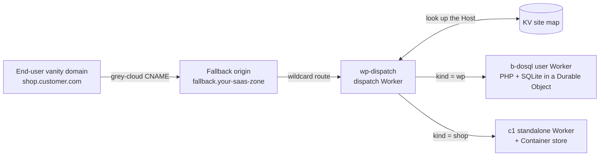
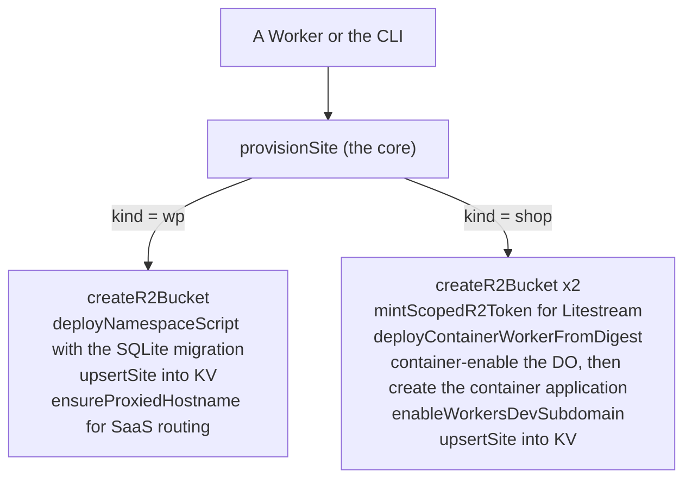

# A multi-tenant WordPress and WooCommerce framework on Workers for Platforms

Run many WordPress sites, and transactional WooCommerce stores, on YOUR OWN Cloudflare Workers for Platforms account, every site provisioned by one command or by a Worker. This is a framework you run on your account, not a hosting product and not a sign-up flow. It is reproducible from these docs on a clean account.

The differentiator: the provisioning core is pure Cloudflare API calls (fetch plus Web Crypto), so the SAME code that a CLI runs can run inside a Worker. A Worker can stand up a new site. Design and proofs: issues #35, #154, #152.

New to this from a traditional LAMP WordPress host (a Linux box with Apache or nginx, PHP, and MySQL)? Start with [docs/from-lamp-to-wfp.md](from-lamp-to-wfp.md), which maps your stack one-to-one onto this one, then come back here for the commands and prerequisites.

## Two kinds of site, and when to use each

| Kind | What it is | Use it for | Not for |
| --- | --- | --- | --- |
| `wp` (b-dosql) | WordPress with PHP and its SQLite in one Durable Object, a user Worker in the dispatch namespace | content sites, and WooCommerce BROWSING served from the edge cache | transactional checkout (the Durable Object isolate hits its 128 MiB limit at checkout) |
| `shop` (c1) | stock WordPress plus WooCommerce in a Cloudflare Container, SQLite on disk, replicated to R2 by Litestream | a real store: guest cart and checkout to a real order | many tiny sites cheaply (a container per store) |

Pick `wp` for a brochure or content site, or a storefront whose shoppers only browse. Pick `shop` when the store takes orders. Both kinds run side by side in one deployment.

## How it fits together

One dispatch Worker routes every site by its hostname. An end user points their own domain at your SaaS zone with a CNAME; the wildcard route hands the request to the dispatcher, which reads the KV site map and runs the right user Worker or container store.



Provisioning is one core, two callers (a CLI or a Worker), branching by kind. Every step is an idempotent Cloudflare API call, so no build runs at provision time.



## What you need (on your own account)

- A Cloudflare account on the **Workers for Platforms Paid** plan, and your **account id**.
- An **API token** with edit on: Workers Scripts, Workers KV, Workers for Platforms, R2, and Account Tokens (the last to mint each store's scoped Litestream key). A provisioning Worker uses a token with the same scopes.
- **Node and Wrangler** (4.107.0 or later), and this repository.
- Built-once artifacts (the provisioning core never builds at provision time):
  - the **b-dosql worker bundle** (for `wp` sites), built with `deploy/wfp` / `spikes/b2-wordpress`;
  - the **c1 worker bundle AND the c1 container image** (for `shop` sites). Build the image once and push it: `wrangler containers push`, which prints a digest ref `registry.cloudflare.com/<your-account>/<repo>@sha256:<digest>`. Every store references that digest; no Docker runs per store.
- The shared pieces once (the dispatch namespace, the KV site map, the outbound Worker): `deploy/wfp/up.sh` makes them. Note the KV site map id; the core reads and writes it.

Nothing is configured in the dashboard; everything below is a command or an API call.

## The one surface: provision a site

The core CLI is `deploy/provision/cli.mjs` (alias it to `site`). It calls `provisionSite`, the same function the provisioning Worker calls.

```sh
export CLOUDFLARE_ACCOUNT_ID=<your account id>
export CLOUDFLARE_API_TOKEN=<the token above>
export WFP_NAMESPACE=wp-wfp
export WFP_KV_ID=<the wp-wfp-sites map id>
export WFP_SUBDOMAIN=<your workers.dev subdomain, or a routed zone>

# a WordPress (content) site
export BDOSQL_BUNDLE_DIR=<the built b-dosql bundle dir>
node deploy/provision/cli.mjs add --kind wp blog

# a WooCommerce store (transactional)
export C1_BUNDLE_DIR=<the built c1 bundle dir>
export C1_IMAGE_REF=registry.cloudflare.com/<your account>/<repo>@sha256:<digest>
node deploy/provision/cli.mjs add --kind shop store
```

Each `add` is idempotent and does only its own site: for `wp` it creates the media bucket, deploys the namespace script with the site's secrets bundled in atomically, and writes the KV routing entry; for `shop` it creates the two buckets (SQLite replica and media), mints a scoped Litestream key, deploys the container Worker from the digest (no build), and records the store. A `shop`'s first request installs WordPress and WooCommerce and takes about a minute; after that a cold start is about 11 to 12 seconds.

Day-two commands follow the same shape (`deploy/wfp/site` for the b-dosql flow today; the core adds `list`/`remove`/`update` over `provisionSite` as it grows): add, remove, list, and update with a snapshot and a way back (see `docs/operator.md`).

## Provision from a Worker (the differentiator)

Because the core is pure `fetch` plus Web Crypto, a Worker can stand up a site. `deploy/provision/worker.mjs` is a minimal example: POST a provision config and it calls the same `provisionSite`.

```sh
curl -X POST https://<your-provisioning-worker>/ \
  -H 'content-type: application/json' \
  --data '{"kind":"wp","name":"blog","namespace":"wp-wfp","kvId":"<KV>","hostname":"blog.example.com","compatibilityDate":"2026-07-01","modules":[...pre-built bundle...],"resourceBindings":[...],"secrets":{...},"buckets":{"media":"wp-wfp-blog-media"}}'
```

The Worker holds a provisioning token (the scopes above) and the pre-built bundle; it never builds an image or a bundle. This is what makes self-serve or automated provisioning possible: your own control plane, or a customer UI, stands up a site by calling a Worker.

## The SaaS zone (one-time setup)

End-user vanity domains reach the dispatcher through one SaaS zone, wired once. The dispatcher (`wp-dispatch`) routes by the request `Host` through the KV site map, so adding a site is a KV entry plus a custom hostname, never a new route.

1. Enable Cloudflare for SaaS on the zone (it needs the SSL-for-SaaS entitlement allocated to the account).
2. Add an originless fallback origin and set it as the zone's SaaS fallback:

```sh
# AAAA fallback.<saas-zone> -> 100:: (proxied), then mark it the fallback origin
curl -X POST "$B/zones/$ZONE/dns_records" -H "$AUTH" \
  --data '{"type":"AAAA","name":"fallback.<saas-zone>","content":"100::","proxied":true}'
curl -X PUT "$B/zones/$ZONE/custom_hostnames/fallback_origin" -H "$AUTH" \
  --data '{"origin":"fallback.<saas-zone>"}'
```

3. Point a `*/*` Worker route at the dispatcher:

```sh
curl -X POST "$B/zones/$ZONE/workers/routes" -H "$AUTH" \
  --data '{"pattern":"*/*","script":"wp-dispatch"}'
```

`*/*` is the Cloudflare-recommended pattern: it catches every custom hostname entering the zone whatever the customer's DNS proxy mode. It also catches the zone's own subdomains, so use a DEDICATED zone with no other traffic. On a zone that also serves your own sites, either exclude them with more-specific routes that name no Worker, or route each vanity domain by its own hostname (`vanity.customer.com`) instead of `*/*`; a per-hostname route only fires when the customer's record is grey-clouded (DNS-only), which is why `*/*` on a dedicated zone is the robust default.

Live reference: this project's own home is `skyphusionwp.dev`. Fallback `fallback.skyphusionwp.dev` (AAAA `100::`), `*/*` to `wp-dispatch`, proven end to end: an end-user vanity domain on a separate zone, grey-cloud CNAME to the fallback, served WordPress over HTTPS with an active certificate.

## Bring your own domain (two ownership modes)

End users reach a site on a vanity domain through Cloudflare for SaaS, routed by the dispatcher. The op `addCustomHostname({mode, dcvDelegation?})` supports two ownership modes that differ ONLY in who places the DNS records.

- **managed** (you or an agency hold the domain, its zone is on an account you control): the op places the CNAME to the SaaS fallback and the DCV record via the API. Hands-off.
- **delegated** (the CUSTOMER holds the domain): the op touches NONE of the customer's DNS. It returns the exact records for the customer to add in their own registrar (the CNAME target and the DCV name and value), then polls until the hostname and certificate are active. With `dcvDelegation`, it also emits a one-time `_acme-challenge` delegation CNAME, so certificate RENEWALS validate automatically without the customer touching DNS again.

**Anti-hostage, and it is the point:** in delegated mode the customer keeps their domain and their registrar, CNAMEs to you, and can repoint away at any time. You never hold their domain. If you move on, they change one CNAME. (This is a direct answer to the agency-holds-your-domain-hostage problem.)

## Honest limits

- A `shop` is ONE container per store: one region, one writer, and a cold-start wait (about 11 to 12 seconds) for the first visitor after the store sleeps. It is not multi-tenant inside the namespace (a container cannot be deployed into the dispatch namespace; issue #147). For many tiny stores, the per-store container cost is real.
- A `wp` site does cached WooCommerce BROWSING well but CANNOT do transactional checkout: the Durable Object isolate hits its 128 MiB memory limit at checkout (that is why `shop` exists).
- Each store's R2 Litestream secret must be SHA-256 of the token value with NO trailing newline; a wrong newline 403s and crashes the container on boot. The core derives it correctly and enforces it (issue #154); do not hand-derive it with `echo`.
- Custom hostnames bill per hostname beyond the Cloudflare for SaaS free allowance.
- A single deployment picks one routing phase for its b-dosql sites (`workers.dev` or custom hostnames); see `docs/operator.md`, "one phase for the whole deployment".

## The architecture, each claim measured

- **Worker-provisionable, build the image once.** A second store deploys from the first store's already-pushed image digest with ZERO build (cross-application image reference), within the account's generous container limits (issues #147, #154, proven live). So one image serves N stores, provisioned via the API.
- **Transactional checkout works.** `tests/woo.py` is 12 of 12 (admin enables cash on delivery, creates a product; a guest adds to cart via the Store API and checks out to a real order, stock decremented), guest checkout 1.3 to 1.7 s (`docs/approach-c1.md`, measured 2026-11-04).
- **Throughput per store scales with the instance.** CPU per request is about 0.15 s and does not change with the instance type, so the ceiling is about vCPU / 0.15 s: about 3 requests per second on `standard-1`, about 6 on `standard-2` (both measured), about 12 and 24 on `standard-3` and `standard-4` (predicted). See `docs/approach-c1.md`.
- **Concurrent multi-site load.** WooCommerce and WordPress sites under concurrent load: issue #152.
- **Isolation.** Each site has its own user Worker or container, Durable Object or SQLite, R2 bucket, secrets, and per-call limits; one site cannot read another's. `deploy/wfp/bindings.py` checks after every upload that a script binds only its own resources.

## Where the detail is

- `docs/operator.md`: the b-dosql day-one walkthrough (scripts, Terraform, update and rollback, custom hostnames, teardown).
- `deploy/provision/README.md`: the provisioning core (ops, orchestration, CLI, Worker, the custom-hostname op).
- `deploy/wfp/README.md`: the Workers for Platforms reference deployment.
- `docs/approach-c1.md`: the c1 container store (design, the measured numbers, the operational notes).
- Issues #35 (the reference deployment), #154 (the Worker-provisionable core), #152 (load), #147 (why a store is standalone).
