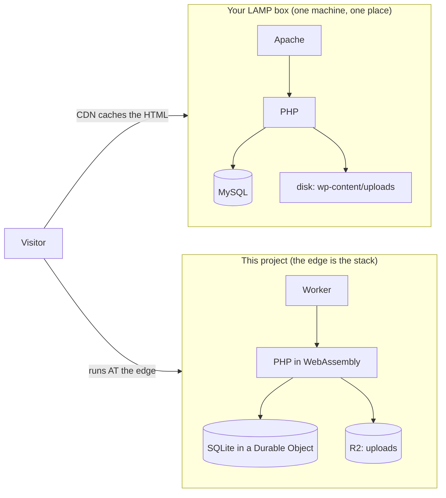
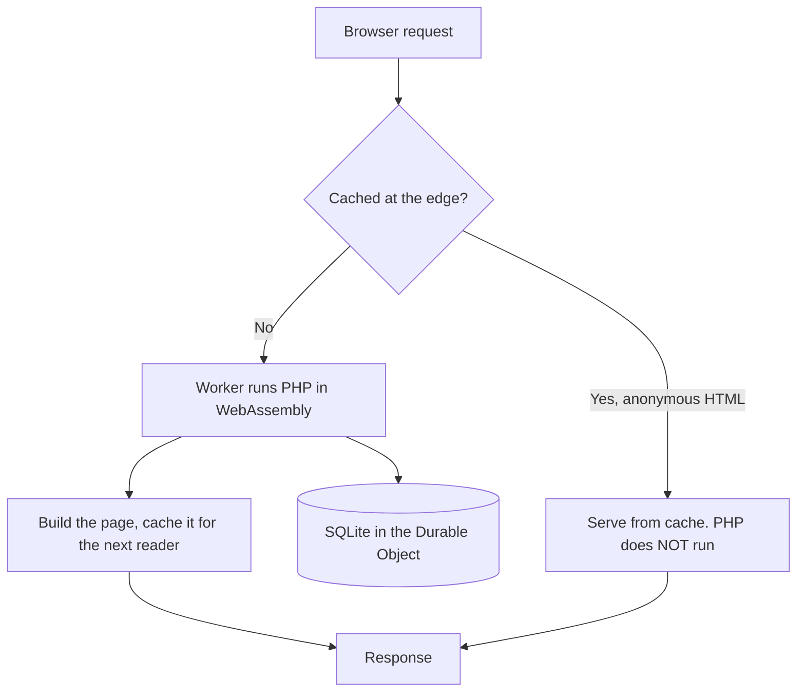
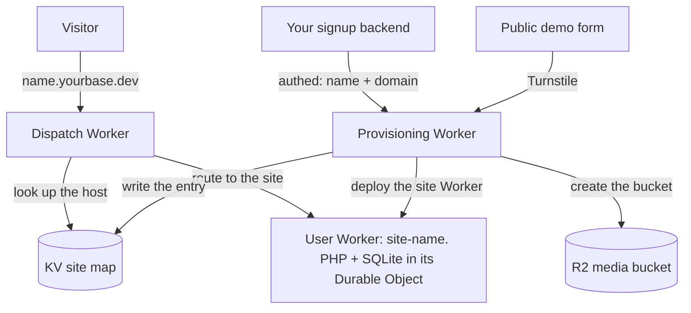

# From a LAMP WordPress host to Workers for Platforms

<!-- VOICE / INTRO: Conrad to tune. The welcoming pitch is his to land; the
     placeholder below is a plain stand-in, not the final voice. Everything from
     "The one idea" down is the substance, meant to stay accurate. -->

If you run WordPress the traditional way, a Linux box with Apache or nginx, PHP, and MySQL, you already know how to run WordPress well. That stack is battle-tested and you know it cold. This page is a translation, not a sales pitch: the same jobs you do now, mapped one-to-one onto Workers for Platforms, so you can do them without a server to keep alive and patch. Where this way gives something up, this page says so plainly.

It leads into the framework quickstart (`docs/framework.md`); read this first if the words "Worker", "Durable Object" and "R2" are new, and the quickstart second for the commands.

## The one idea

On a LAMP box, every request travels to one machine in one place, and the CDN only caches what that machine already produced. Here, **there is no origin server. The edge is the stack.** The request is served at the Cloudflare location nearest the visitor, and WordPress runs there. The database, the uploads, and the scheduled jobs all moved onto Cloudflare's own services.

## The one-to-one map

| What you do on a LAMP host | The same job here | Notes |
| --- | --- | --- |
| SSH into a VPS to run or change the site | There is no box to SSH into. A site is a deployed Worker. | You change a site by redeploying its artifact, not by logging in. |
| Apache/nginx + PHP-FPM you install and tune | The Worker is the web tier, and it runs PHP compiled to WebAssembly, at every edge location. | The same PHP and the same WordPress; you just do not operate the host. |
| MySQL or MariaDB server | SQLite inside the site's Durable Object (the `b-dosql` path): one tenant, one database, in the same place PHP runs, so a query is not a network hop. Or D1, or your own MySQL over Hyperdrive if you bring one. | No database server for you to run, back up, or secure. |
| `wp-content/uploads` on local disk | R2 (object storage). The media library reads and writes R2. | There is no local disk at the edge. |
| cPanel/WHM, or a script, to spin up a new site | `deploy/deploy.sh up <name>` for one site, `deploy/wfp` for a fleet, or an authed call to the provisioning Worker. | The provisioning is itself a Worker you can call; no control panel. |
| System cron and `wp-cron` | A Durable Object alarm runs WP-Cron and Action Scheduler off a durable timer, not off visitor traffic. | No crontab on a box. |
| LiteSpeed cache, W3 Total Cache, a Redis object cache | The Workers edge cache (built in, for logged-out pages) plus a drop-in object cache in the runtime. | You do not install a caching plugin for the edge layer; it is the platform. |
| SSH in and patch WordPress or a plugin in place | You do not patch in place. The code lives in the bundle; you rebuild the artifact for a new WordPress or WooCommerce version and redeploy. | No drift between what is on the box and what the config says. |
| A pet server you keep warm | Disposable. A site is created and torn down by command. | A `b-dosql` site sleeps when idle and cold-starts quickly on the next request. |

## Where a request actually goes

A logged-out reader almost always gets a cached page and never wakes PHP. A write (logging in, checking out, saving a post) runs PHP and the database.

The win over a LAMP box: cached reads are served at the edge with no server round trip, and the database for the common path is in the same place PHP runs, so a query is not a network hop.

## WooCommerce, and the one real limit

WooCommerce runs on `b-dosql`, **including checkout** (measured on Workers Paid: an order places at `x-wasm-mib` 99, under the 128 MiB isolate cap, with zero memory overflow, `tests/woo.py` green). Admin media upload works too. So a light-to-moderate store runs on the edge with no container and no external database.

The one real limit is the Worker isolate: **128 MiB, one writer, one region.** A blog or a light-to-moderate store fits comfortably. A store with real concurrent traffic should use **approach A** (PHP in a Worker, a managed MySQL through Hyperdrive; see [onboarding.md](onboarding.md)), which scales sideways. A store that outgrows b-dosql can also go to a **VPS** (the standard LAMP stack you already know). The container store path that used to fill that role was retired (#214) because b-dosql proved capable; see the README matrix.

## One account, many sites (the framework)

The project is not one site. It is a framework that mints many sites on your own account, each its own Worker, routed by a shared dispatcher, provisioned by one command or by a provisioning Worker.

The provisioning Worker builds every site from one trusted config, so the tenant brings only a name and a domain, never a Cloudflare setting. There are two front doors: a private one your signup backend calls, and a Turnstile-gated public demo that mints throwaway, self-expiring sites.

## The process: declare and provision, instead of provision and install

On a LAMP host the shape is: get a VPS or a cPanel account, install WordPress, configure it by hand. The running state then lives on the box, and your notes drift from what the box actually does.

Here the shape is inverted: you DECLARE a site, its name and its domain, and provision it with one command or a Worker call. The whole fleet is code: committed to git, reviewed as a diff, applied for the data plane, and rolled back the same way. The map of which hostname serves which site is a record you read, not something you hold in your head. A hand-built LAMP box could never be diffed or rolled back as a unit; a declared fleet can.

## What you gain, and what you give up

You gain:
- No server to patch, and nothing that drifts: a site is an artifact, versioned and disposable.
- Per-site isolation by construction: each site has its own database, its own R2 bucket, its own secrets, its own per-request limits; one site cannot read another's.
- The edge cache and R2 media without installing or tuning plugins for them.
- Provisioning that a Worker can do, so a control plane or a customer UI can stand up a ready, installed site, not just a human at a shell.

You give up, or must plan around (stated plainly, because they are real):
- One routing phase per deployment: a deployment's sites are all on `workers.dev`, or all on custom hostnames; you pick one, you do not mix them.
- The 128 MiB isolate, one writer, one region: fine for a blog or a light-to-moderate store, but a heavily loaded store belongs on a VPS, not the edge.
- You update by rebuilding and redeploying the artifact, not by editing files on a live box. That removes drift, and it is a change of habit.

## What a normal host does for you, and how this does it

A LAMP box gives WordPress a filesystem, a MySQL socket, a mail transport, image libraries, a cron daemon and an object cache, all for free. The edge gives none of those directly, so this stack rebuilds each one as a small drop-in. The list is worth knowing, because it tells you where a plugin that reaches around the drop-in will break.

| A normal host gives you | How this stack provides it | A plugin can break here if it |
| --- | --- | --- |
| MySQL | the database is SQLite (in the site's Durable Object) or D1, reached through a `db.php` driver, a PDO stand-in and a SQL-dialect rewriter | runs raw MySQL-only SQL (stored procedures, some built-in functions, full-text search) that the rewriter does not cover |
| Outbound HTTP from PHP | `wp_remote_*` is handed to the Worker, which makes the request with `fetch()`, against an allowlist | opens a raw socket (`fsockopen`, a direct cURL handle) instead of the WordPress HTTP API |
| A writable uploads directory | the media library is stored in R2 through the Worker | writes files straight to `wp-content/uploads` on disk instead of through the media API |
| GD or Imagick | resize, crop and rotate go to Cloudflare Images | does its own pixel work in PHP |
| Redis, Memcached or APCu | a drop-in object cache backed by the Worker runtime | assumes one specific cache backend is present |
| A sendmail or SMTP socket | `wp_mail()` goes through the Worker and Cloudflare Email Service | talks to an SMTP server over a socket itself |
| A cron daemon | WP-Cron and Action Scheduler are run on a Durable Object alarm, not by visitor traffic | depends on real system cron timing |
| Installing or editing plugins and themes from wp-admin | plugins and themes are pinned by content hash in the build and shipped as an artifact | expects to install, update or edit itself from the dashboard on a live site |
| Real SQL transactions | restored by a drop-in whose embedded SQLite API does not expose them natively | (this one works; it is listed so you know it had to be restored) |

None of these is a dead end: each is handled. The point is that the handling is explicit, so a plugin that assumes a traditional host instead of using the WordPress APIs is the thing to test before you rely on it. `docs/plugins.md` is how a standard plugin set is checked against each setup.

Every number here is measured; the sources are in the framework quickstart's architecture section (`docs/framework.md`) and `docs/results.md`. Next: the quickstart, for the commands and the prerequisites.
