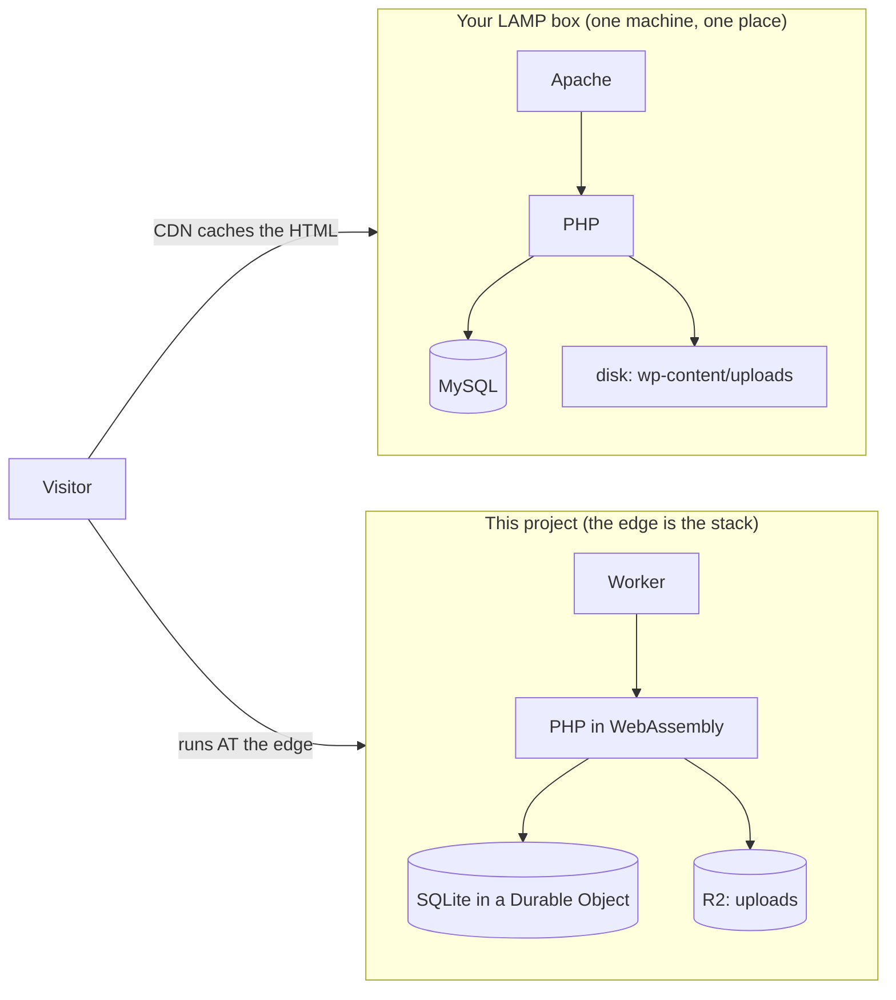
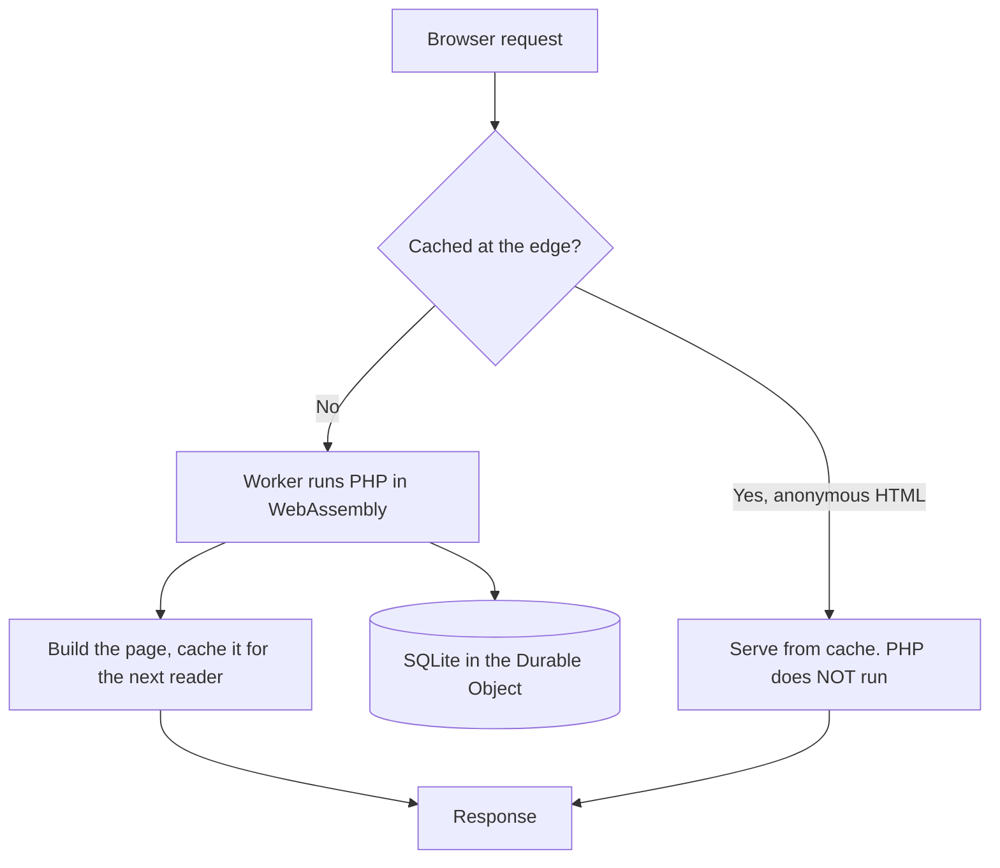
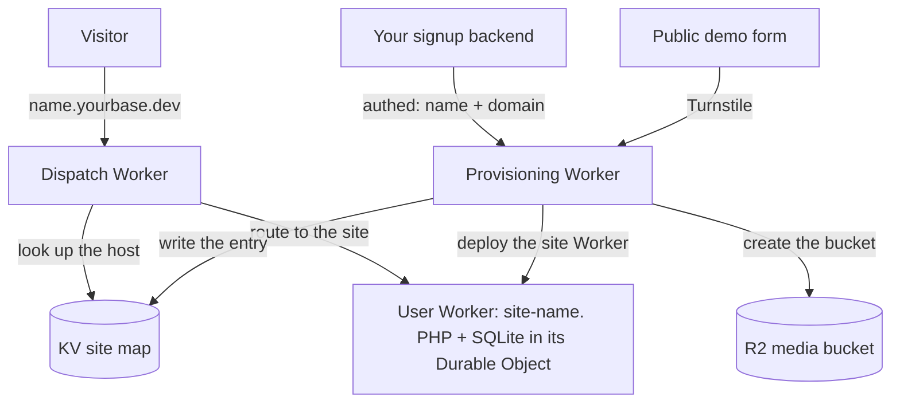

# From a LAMP WordPress host to Workers for Platforms

If you run WordPress the traditional way, on a Linux box with Apache or nginx, PHP and MySQL, you
already know how to run WordPress well. That stack is battle-tested, and you know it cold. This
page is a translation, not a sales pitch. It maps the jobs you do now, one to one, onto Workers for
Platforms, so you can do them without a server to keep alive and patch. Where this way gives
something up, we say so plainly.

It leads into the framework quickstart (`docs/guide/framework.md`). If the words "Worker", "Durable
Object" and "R2" are new to you, read this page first and the quickstart second, for the commands.
In short: a Worker is code that Cloudflare runs at its edge locations; a Durable Object is one
Cloudflare object that keeps state, here a site's PHP and its SQLite database (the built-in database option, `b-dosql` in the commands; the MySQL option is approach A); R2 is Cloudflare's
object storage.

## The one idea

On a LAMP box, every request travels to one machine in one place, and the CDN only caches what that machine already produced. Here, **there is no origin server. The edge is the stack.** The request is served at the Cloudflare location nearest the visitor, and WordPress runs there. The database, the uploads, and the scheduled jobs all moved onto Cloudflare's own services.

## Which Cloudflare plan you need

Cloudflare sells these as separate plans, and each one opens a different path. This is where each
path stands today, measured:

| Plan | What runs on it today |
| --- | --- |
| Workers Free | Plain WordPress and a light storefront. On `b-dosql` the installer, the pages, the login, the dashboard and the editor work, and a WooCommerce shop, cart and checkout work, on both engines. Editing a WooCommerce store does not fit Free's memory limit, so a store you edit needs Workers Paid. Measured 2026-11-15 ([#638](https://github.com/skyphusion-labs/pagefeather/issues/638)). |
| Workers Paid | The tier for a store you edit. WordPress and WooCommerce, checkout included, on `b-dosql` (PHP and SQLite in one Durable Object). |
| Workers for Platforms Paid | The framework itself: many sites on one account, each its own Worker, routed by one dispatcher (below). This is the path to go big. A pagefeather Workers for Platforms account costs $30 a month for two or more sites. That is the Workers for Platforms Paid plan ($25) plus the Workers Paid plan ($5). The reference account runs both. The Workers for Platforms price includes 20 million requests, then $0.30 per million. It includes 60 million CPU ms, then $0.02 per million. It includes 1,000 namespace scripts, then $0.02 each. Another site at rest costs about $0, up to the 1,000 included scripts. Cloudflare's WfP pricing page does not say whether Workers Paid is strictly required, so plan for both ([cost.md](cost.md)). |
| Workers Paid plus your own MySQL | Approach A: PHP in a Worker, MySQL through Hyperdrive. This is the path that scales out to real concurrent traffic ([onboarding.md](onboarding.md)). |

The README's plan table has the full verdicts, with the numbers and dates behind each one.

## The one-to-one map

| What you do on a LAMP host | The same job here | Notes |
| --- | --- | --- |
| SSH into a VPS to run or change the site | There is no box to SSH into. A site is a deployed Worker. | You change a site by redeploying its artifact, not by logging in. |
| Apache/nginx + PHP-FPM you install and tune | The Worker is the web tier, and it runs PHP compiled to WebAssembly, at every edge location. | The same PHP and the same WordPress; you just do not operate the host. |
| PHP-FPM restarting its workers (`pm.max_requests`) | The PHP runtime is recycled when its WebAssembly memory passes a line, `RECYCLE_WASM_MIB` (default 100 MiB), a per-site setting (#602). | The line is memory, not a request count, and you do not tune process pools. |
| MySQL or MariaDB server | SQLite inside the site's Durable Object (the `b-dosql` path): one tenant, one database, in the same place PHP runs, so a query is not a network hop. Or your own MySQL over Hyperdrive (approach A), if you bring one. | No database server for you to run, back up, or secure on `b-dosql`. |
| `wp-content/uploads` on local disk | R2 (object storage). The media library reads and writes R2. | There is no local disk at the edge. |
| cPanel/WHM, or a script, to spin up a new site | `deploy/wfp/site add <name>`, the one operator command for a site (#294), or an authed call to the provisioning Worker. | The provisioning is itself a Worker you can call; no control panel. |
| System cron and `wp-cron` | A Durable Object alarm runs WP-Cron and Action Scheduler off a durable timer, not off visitor traffic. | No crontab on a box. |
| LiteSpeed cache, W3 Total Cache, a Redis object cache | The Workers edge cache (built in, for logged-out pages) plus a drop-in object cache in the runtime. | You do not install a caching plugin for the edge layer; it is the platform. |
| SSH in and patch WordPress or a plugin in place | You do not patch in place. Core, plugins and themes are part of the build; you rebuild the artifact for a new WordPress or WooCommerce version and redeploy. | No drift between what is on the site and what the config says. |
| A pet server you keep warm | Disposable. A site is created and torn down by command. | A `b-dosql` site sleeps when idle and wakes on the next request. |

## Where a request actually goes

A logged-out reader almost always gets a cached page and never wakes PHP. A write (logging in, checking out, saving a post) runs PHP and the database.

The win over a LAMP box: cached reads are served at the edge with no server round trip, and the database for the common path is in the same place PHP runs, so a query is not a network hop.

## Plugins and themes: in the build, not installed from wp-admin

This is the biggest change of habit, so it gets its own section.

On a LAMP host you install, update and edit plugins from wp-admin. Here every site is code-locked:
the generated `wp-config.php` sets `DISALLOW_FILE_MODS` and `DISALLOW_FILE_EDIT`, and installing,
updating or removing core, a plugin or a theme is a code deploy (#458). You list wordpress.org
plugins and themes by slug (`PLUGINS=`, `THEMES=`), each pinned by version and SHA-256, and the
build stops on a slug that is not pinned or a zip whose hash does not match (#457). Activating and
deactivating a plugin, and switching themes, still work in wp-admin.

Why this is good for you as well as a limit: nobody can install or edit PHP code on a live site,
not an attacker with a stolen admin password and not a well-meaning client. What runs is exactly
what you built and reviewed, and an update is a rebuild you can test first and roll back. The
detail is in `deploy/wfp/README.md` and the [evidence](../plugins.md).

The code ships with the build. By default (#595), most of the plugin, theme and OPcache files sit
next to the site Worker as remote packs, fetched as PHP needs them, instead of inside the Worker
bundle ([evidence](../site-remote-569.md)). You do not need to do anything for this.

## WooCommerce, and the one real limit

WooCommerce runs on `b-dosql`, **including checkout** (measured on Workers Paid: an order places at `x-wasm-mib` 99, with zero memory overflow, `tests/woo.py` green). That measurement is under the measured write ceiling (117 to 119 MiB of wasm; see [memory limits](limits.md#memory-limits-the-three-figures)). Admin media upload works too. A light-to-moderate store runs on the edge with no container and no external database.

The one real limit is the Worker isolate: one writer, one region. The limit that binds a site is the measured write ceiling (117 to 119 MiB of wasm; see [memory limits](limits.md#memory-limits-the-three-figures)). A blog or a light-to-moderate store fits under that write ceiling. A store with real concurrent traffic should use **approach A** (PHP in a Worker, a managed MySQL through Hyperdrive; see [onboarding.md](onboarding.md)), which scales sideways. A store that outgrows b-dosql can also go to a **VPS** (the standard LAMP stack you already know). The container store path that used to fill that role was retired (#214) because b-dosql proved capable; see the README matrix.

### Stock numbers on cached pages

A logged-out product page comes from the edge cache, so a guest can see an old stock number.

- **What you see.** A product page is cached for 120 s (`PAGE_CACHE_TTL`). A checkout that lowers the stock number does not clear that copy. So after a sale, a guest can see "7 in stock" for up to 120 s when there are 6. Measured on a b-dosql store: 121 s ([#628](https://github.com/skyphusion-labs/pagefeather/issues/628), 2026-11-15).
- **The worst case.** After a quiet spell, the first visitor can get an older copy. It can be up to about 12 minutes old. The next visitor gets the new one.
- **A sold-out product is different.** When the stock status changes to out of stock, the cache is cleared. Measured: every page said "out of stock" within 23 s of its sale.
- **No oversell.** The checkout always reads the real stock. A guest who sees an old number cannot buy more than you have.

**Why it is not cleared on every sale.** On a LAMP host, a page cache plugin can clear a product page on every stock change. Here a cache clear empties every cached page of the site. Cloudflare allows only 5 clears a minute for the whole account. Every site on the account shares them. A busy store would use them up. Then even the sold-out clears would be refused. So the cache is cleared on a stock status change only.

**The setting that avoids it.** In WooCommerce, go to **Settings > Products > Inventory > Stock display format**:

| Setting | What a guest sees on a cached page |
| --- | --- |
| Always show quantity remaining in stock (the WooCommerce default) | an exact number, which can be up to 120 s old |
| Only show quantity remaining in stock when low | "In stock", and a number only at or below the low stock threshold. That number can be up to 120 s old. |
| Never show quantity remaining in stock | "In stock" or "Out of stock" only. That changes within about 25 s. |

For a busy store, "Never show quantity" is the choice that keeps every cached page right.

**The store default since #628.** A store caches its product, shop and category pages for 30 s, not 120 s. The setting is `PAGE_CACHE_PRODUCT_TTL`. So there an exact number is usually at most about 30 s old. After a quiet spell, the first visitor can get a copy up to 60 s old. That is the 30 s, plus a 30 s stale-while-revalidate window (#699). Measured: 30 s, with no loss of cached reads and no extra cache clears ([#628](https://github.com/skyphusion-labs/pagefeather/issues/628), 2026-11-15). deploy/wfp, the one-click paths and deploy.sh all render that default.

## The admin is the heaviest part, and still being worked on

A heavy wp-admin screen, such as the block editor on a large store, needs far more memory than a
storefront page. We test it on a fixed WooCommerce sample store (2,609 products and 900 orders,
`tests/fixtures/sample-store.env`), never on an empty site, so the numbers are close to a real
store.

Where it stands, plainly:

- In our 7-screen admin round on that store, the remote packs (now the default, #595) took the
  lost requests from 95 of 210 to 5 of 210 ([evidence](../admin-memory-matrix.md), the
  D/R row, 2026-11-14). Every save that answered 302 read back on both arms.
- Five lost of 210 is still not zero, and the editor screens are where it happens.
- Whether wp-admin runs on Workers or in a Cloudflare Container is still an open question. It is
  decided after the new engine is fully tested. Meanwhile, the admin memory work on the Durable
  Object path continues (#394, #582).
- A leaner PHP engine is in progress (#582: #587, #592), measured in CI but not yet shipped to
  sites.
- A heavy plugin set can pass the measured write ceiling (117 to 119 MiB of wasm; see [memory limits](limits.md#memory-limits-the-three-figures)) on any page. The measured case is in
  [limits.md](limits.md).

## One account, many sites (the framework)

The project is not one site. It is a framework that makes many sites on your own account, each its own Worker, routed by a shared dispatcher, provisioned by one command or by a provisioning Worker.

The provisioning Worker builds every site from one trusted config, so the tenant brings only a name and a domain, never a Cloudflare setting. There are two front doors: a private one your signup backend calls, and a Turnstile-gated public demo that makes throwaway, self-expiring sites.

## The process: declare and provision, instead of provision and install

On a LAMP host the shape is: get a VPS or a cPanel account, install WordPress, configure it by hand. The running state then lives on the box, and your notes drift from what the box actually does.

Here the shape is the other way round: you declare a site, its name and its domain, and provision it with one command or a Worker call. The whole fleet is code: committed to git, reviewed as a diff, applied for the data plane, and rolled back the same way. The map of which hostname serves which site is a record you read, not something you hold in your head. A hand-built LAMP box can not be diffed or rolled back as a unit; a declared fleet can.

## What you gain, and what you give up

You gain:
- No server to patch, and nothing that drifts: a site is an artifact, versioned and disposable.
- Per-site isolation by construction: each site has its own database, its own R2 bucket, its own secrets, its own per-request limits; one site cannot read another's.
- The edge cache and R2 media without installing or tuning plugins for them.
- No code changes on a live site: plugins and themes are pinned in the build, so what runs is what you reviewed.
- Provisioning that a Worker can do, so a control plane or a customer UI can stand up a ready, installed site, not just a human at a shell.

You give up, or must plan around (stated plainly, because they are real):
- One routing phase per deployment: a deployment's sites are all on `workers.dev`, or all on custom hostnames; you pick one, you do not mix them.
- The 128 MiB isolate, one writer, one region: fine for a blog or a light-to-moderate store. A heavily loaded store belongs on approach A (your own MySQL through Hyperdrive) or on a VPS.
- Heavy admin screens on a large store can still lose a request (above).
- You update by rebuilding and redeploying the artifact, not by editing files on a live box. That removes drift, and it is a change of habit.

## What a normal host does for you, and how this does it

A LAMP box gives WordPress a filesystem, a MySQL socket, a mail transport, image libraries, a cron daemon and an object cache, all for free. The edge gives none of those directly, so this stack rebuilds each one as a small drop-in. The list is worth knowing, because it tells you where a plugin that reaches around the drop-in will break.

| A normal host gives you | How this stack provides it | A plugin can break here if it |
| --- | --- | --- |
| MySQL | the database is SQLite (in the site's Durable Object) or D1, reached through a `db.php` driver, a PDO stand-in and a SQL-dialect rewriter | runs raw MySQL-only SQL (stored procedures, some built-in functions, full-text search) that the rewriter does not cover |
| Outbound HTTP from PHP | `wp_remote_*` is handed to the Worker, which makes the request with `fetch()`, against an allowlist | opens a raw socket (`fsockopen`, a direct cURL handle) instead of the WordPress HTTP API |
| A writable uploads directory | the media library is stored in R2 through the Worker | writes files straight to `wp-content/uploads` on disk instead of through the media API |
| GD or Imagick | resize, crop and rotate go to Cloudflare Images | does its own pixel work in PHP |
| Redis, Memcached or APCu | a drop-in object cache backed by the Worker runtime | assumes one specific cache backend is present |
| A sendmail or SMTP socket | `wp_mail()` goes through the Worker and Cloudflare Email Service | talks to an SMTP server over a socket itself |
| A cron daemon | WP-Cron and Action Scheduler are run on a Durable Object alarm, not by visitor traffic | depends on real system cron timing |
| Installing or editing plugins and themes from wp-admin | plugins and themes are pinned by content hash in the build and shipped as an artifact; the site is code-locked | expects to install, update or edit itself from the dashboard on a live site |
| Real SQL transactions | restored by a drop-in whose embedded SQLite API does not expose them natively | (this one works; it is listed so you know it had to be restored) |

None of these is a dead end: each is handled. The point is that the handling is explicit, so a plugin that assumes a traditional host instead of using the WordPress APIs is the thing to test before you rely on it. `docs/plugins.md` is how a standard plugin set is checked against each setup.

Every number here is measured; the sources are in the framework quickstart's architecture section (`docs/guide/framework.md`), `docs/results.md` and the pages linked above. When you are ready, the quickstart has the commands and the prerequisites. Questions, and reports of a plugin that breaks, are welcome as issues.
